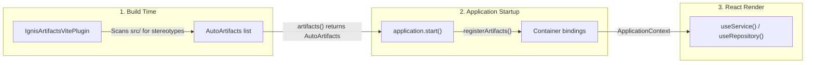

# Dependency Injection

ARDOR applications use IGNIS inversion of control directly inside the browser. The container manages services, repositories, datasources, and configuration options as singletons throughout the tab session.

You decorate your classes with stereotype decorators, the Vite build plugin discovers them and registers them into the application container at startup, and React components resolve them using typed hooks such as `useService` and `useRepository`.

```tsx
import React from 'react';
import { BaseService, service, useService } from '@venizia/ardor';

@service()
export class PriceCalculationService extends BaseService {
  constructor() {
    super({ scope: PriceCalculationService.name });
  }

  calculate(opts: { amount: number }): number {
    return opts.amount * 1.1;
  }
}

export function PriceDisplay(props: { amount: number }) {
  const priceService = useService({ target: PriceCalculationService });
  const total = priceService.calculate({ amount: props.amount });

  return <span>Total: {total}</span>;
}
```

## The dependency injection flow



## The container is the application

In ARDOR, there is no detached dependency injection container passed between subsystems. `BaseArdorApplication` in `packages/kernel/src/base/applications/abstract.ts` extends `Container` from `@venizia/ignis-inversion` directly. The application instance *is* the container. A binding associates a string key (such as `'services.PriceCalculationService'` or `CoreBindings.APPLICATION_INSTANCE`) with a class, a provider factory, or a constant value. When a component or class resolves that key, the container returns the cached instance or constructs it according to its scope.

`preConfigure()` itself binds three keys: `CoreBindings.APPLICATION_INSTANCE`, `CoreBindings.APPLICATION_INFO`, and `CoreBindings.FEATURES` (see [Configuration](./configuration) for the exact execution order). Everything else is bound by the application through `@provide` methods, `bindingList()`, `bindContext()`, or stereotype discovery in `registerArtifacts()`.

## Stereotype decorators and derived keys

ARDOR exports four primary class stereotypes from `@venizia/ardor` (re-exported from `packages/kernel/src/base/metadata/index.ts`):

- `@service()` - registers business logic and coordination classes into the `services` namespace.
- `@repository()` - registers data access classes into the `repositories` namespace.
- `@datasource()` - registers transport and connection classes into the `datasources` namespace.
- `@component()` - registers reusable framework add-ons into the `components` namespace.

Each decorator derives a conventional binding key in the format `<namespace>.<ClassName>`:

| Stereotype decorator | Namespace | Default derived key |
| --- | --- | --- |
| `@service()` | `services` | `services.<ClassName>` |
| `@repository()` | `repositories` | `repositories.<ClassName>` |
| `@datasource()` | `datasources` | `datasources.<ClassName>` |
| `@component()` | `components` | `components.<ClassName>` |

The decorator records the derived key in `MetadataRegistry` on the class constructor. When code resolves a dependency by passing `{ target: ClassName }`, ARDOR reads this recorded key directly from metadata. You do not need to construct or hard-code key strings.

## Build discovery: AutoArtifacts and Vite

In the browser, there is no server-side filesystem to scan at runtime. ARDOR discovers decorated classes at build time using `AutoArtifacts` and `IgnisArtifactsVitePlugin`.

### 1. Vite plugin configuration

In `vite.config.ts`, include `IgnisArtifactsVitePlugin.create()`:

<<< @/../../../examples/5-mins-qs/vite.config.ts{ts}

The plugin scans the TypeScript files under `src/` when the Vite development server starts. It performs two critical jobs:
- **Builds the class index**: It finds every class decorated with a stereotype and bundles the list into the virtual module `@venizia/ignis-boot/auto`.
- **Pins class names**: Production minifiers rename classes (for example, `PriceCalculationService` becomes a short identifier like `a`). Because derived keys depend on `Class.name`, the plugin pins each class name with a static property so the runtime key matches the build-time key.

> [!NOTE]
> `IgnisArtifactsVitePlugin` scans `src/` once when the dev server starts and caches the result. Editing an existing class triggers standard hot module replacement. However, when you add or delete a decorated class, you must restart `vite dev` so the plugin re-scans the directory.

### 2. Mounting AutoArtifacts in the application

In `src/application.ts`, return `AutoArtifacts` from `artifacts()`:

<<< @/../../../examples/5-mins-qs/src/application.ts{ts}

When `application.start()` runs, `registerArtifacts()` verifies that every class listed in `AutoArtifacts` was discovered and binds each under its derived key as a singleton.

> [!WARNING]
> Keep `src/application.ts` free of decorated classes. The module that imports `AutoArtifacts` must never declare decorated classes or be imported by modules that declare decorated classes. Violating this rule creates an import cycle that crashes during startup.

### 3. By-hand alternative in `bindContext()`

If you prefer not to use build-time discovery, or need to register third-party classes, register them by hand in `bindContext()`:

```ts
import { BaseArdorApplication, type IApplicationInfo } from '@venizia/ardor';

export class PricingService {
  getPrice(opts: { id: string }): number {
    return 100;
  }
}

export class ShopApplication extends BaseArdorApplication {
  getAppInfo(): IApplicationInfo {
    return { name: 'shop', version: '1.0.0', description: 'Shop admin' };
  }

  bindContext(): void {
    this.service(PricingService);
  }
}
```

The application provides helper methods for registration by hand:
- `this.service(Target)` - binds under `services.<Target.name>` as a singleton.
- `this.repository(Target)` - binds under `repositories.<Target.name>` as a singleton.
- `this.dataSource(Target)` - binds under `datasources.<Target.name>` as a singleton.
- `this.component(Target)` - binds under `components.<Target.name>` as a singleton.

Each method records the binding key on the class in `MetadataRegistry` so that `{ target: Target }` resolution works identically to decorated discovery. You can also override `bindingList()` to bind classes under literal keys before `bindContext()` executes.

## Resolving dependencies from React components

React components resolve dependencies through typed hooks exported from `@venizia/ardor`.

### Hook selection table

| I want to resolve | Hook to use | Accepted options | What it checks |
| --- | --- | --- | --- |
| A repository | `useRepository` | `{ target: TClass<T> }` or `{ key: TUseInjectableKeys }` | Throws when the class is bound under another namespace. |
| A service | `useService` | `{ target: TClass<T> }` or `{ key: TUseInjectableKeys }` | Throws when the class is bound under another namespace. |
| A provider | `useProvider` | `{ target: TClass<T> }` or `{ key: TUseInjectableKeys }` | Throws when the class is bound under another namespace. |
| A configuration | `useConfiguration` | `{ target: TClass<T> }` or `{ key: TUseInjectableKeys }` | Throws when the class is bound under another namespace. |
| A component | `useComponent` | `{ target: TClass<T> }` or `{ key: TUseInjectableKeys }` | Throws when the class is bound under another namespace. |
| Any binding or core key | `useInjectable` | `{ target: TClass<AnyType> }` or `{ key: TUseInjectableKeys }` | Resolves any binding across all namespaces or `CoreBindings`. |
| The active DI container | `useInjectableContainer` | `{ container?: Container }` (optional) | Returns `opts.container` else the context container and throws when neither exists. |
| The application container | `useApplicationContext` | None | Returns the container and throws outside the application context. |
| The application logger | `useApplicationLogger` | None | Returns the application logger and throws outside the application context. |

When resolving with `{ target }`, TypeScript automatically infers the return type from the class constructor without manual type casting.

### Complete component example

The following component resolves a repository, a service, the application container, and the REST data provider:

```tsx
import React from 'react';
import {
  BaseService,
  CoreBindings,
  datasource,
  type IDataProvider,
  repository,
  RepositoryTypes,
  service,
  useApplicationContext,
  useInjectable,
  useRepository,
  useService,
} from '@venizia/ardor';
import { HttpDataSource, HttpRepository } from '@venizia/ardor/repository';

export interface IProduct {
  id: number;
  name: string;
  price: number;
}

@datasource()
export class CatalogDataSource extends HttpDataSource {
  constructor() {
    super({ baseUrl: '/api' });
  }
}

@repository({ type: RepositoryTypes.REMOTE, dataSource: CatalogDataSource })
export class ProductRepository extends HttpRepository<IProduct> {
  constructor(dataSource: CatalogDataSource) {
    super({ dataSource, resource: 'products' });
  }

  countActive() {
    return this.count({ where: { price: { gte: 0 } } });
  }
}

@service()
export class CurrencyService extends BaseService {
  constructor() {
    super({ scope: CurrencyService.name });
  }

  format(opts: { amount: number; currency: string }): string {
    return `${opts.amount} ${opts.currency}`;
  }
}

export function ProductCatalogCard() {
  const products = useRepository({ target: ProductRepository });
  const currency = useService({ target: CurrencyService });
  const container = useApplicationContext();
  const dataProvider = useInjectable<IDataProvider>({
    key: CoreBindings.DEFAULT_REST_DATA_PROVIDER,
  });

  const [totalCount, setTotalCount] = React.useState<number>(0);

  React.useEffect(() => {
    void products.countActive().then(({ count }) => {
      setTotalCount(count);
    });
  }, [products]);

  return (
    <div>
      <p>Container ready: {container ? 'yes' : 'no'}</p>
      <p>Data provider ready: {dataProvider ? 'yes' : 'no'}</p>
      <p>Sample price: {currency.format({ amount: 100, currency: 'USD' })}</p>
      <p>Total active products: {totalCount}</p>
    </div>
  );
}
```

## Injecting dependencies into a class

Classes instantiated by the container declare their dependencies in their constructor parameters using `@inject({ key })`.

Every constructor parameter of a container-instantiated class must carry `@inject`. The check is made when the container instantiates the class (IGNIS `instantiate()`, which refuses missing metadata with `[ClassName] Constructor parameter N has no @inject | Every parameter of a container-instantiated class must be decorated - the container cannot supply an undecorated one`), not during startup. Mixing decorated and undecorated parameters is refused because the container cannot supply values for undecorated parameters. Pass any class options to `super({ scope: ClassName.name })`, never as an undecorated parameter.

This rule has one exception: a `@repository`-decorated class whose first constructor parameter is its datasource needs no `@inject`, because the `@repository` decorator programmatically writes that injection metadata (`registry.setInjectMetadata({ target, index: 0, ... })`) even though no literal `@inject` appears in source. The `ProductRepository` class in the component example above is exactly that case.

Here is a complete service that injects another service through its constructor:

```ts
import { BaseService, inject, service } from '@venizia/ardor';

@service()
export class AuditLogService extends BaseService {
  constructor() {
    super({ scope: AuditLogService.name });
  }

  record(opts: { action: string; resource: string }): void {
    this.logger.info('[audit] action: %s | resource: %s', opts.action, opts.resource);
  }
}

@service()
export class OrderProcessingService extends BaseService {
  constructor(
    @inject({ key: 'services.AuditLogService' })
    private readonly auditLogService: AuditLogService,
  ) {
    super({ scope: OrderProcessingService.name });
  }

  processOrder(opts: { orderId: string }): void {
    this.auditLogService.record({ action: 'process', resource: opts.orderId });
    this.logger.info('[order] processed order %s', opts.orderId);
  }
}
```

When `OrderProcessingService` is resolved, the container resolves `services.AuditLogService` first and passes the instance into the constructor. The key `'services.AuditLogService'` is the derived `<namespace>.<ClassName>` and changes if a minifier renames the class unless the plugin pins it (which `IgnisArtifactsVitePlugin` does for the classes it lists).

## Scopes: singleton by default in the browser

In ARDOR, all registrations (`@service`, `@repository`, `@datasource`, `@component`, `@configuration`, `this.service()`, `this.repository()`, and `bindingList()`) default to `BindingScopes.SINGLETON`.

In IGNIS server applications, services and repositories default to `TRANSIENT`. In the browser, ARDOR defaults to `SINGLETON` as explained in `packages/kernel/src/base/applications/abstract.ts`:

> Every kind defaults to SINGLETON (IGNIS's server uses transient): a hook resolves on every render.

In React, components re-render frequently: with a transient scope each render would receive a new instance.

Singletons live as long as the browser tab stays open. Opt out to `BindingScopes.TRANSIENT` only when an instance must hold mutable, caller-specific state that cannot be shared:

```ts
import { BaseArdorApplication, type IApplicationInfo } from '@venizia/ardor';
import { BindingScopes } from '@venizia/ignis-inversion';

export class DraftBuffer {
  private content = '';

  setContent(value: string): void {
    this.content = value;
  }

  getContent(): string {
    return this.content;
  }
}

export class EditorApplication extends BaseArdorApplication {
  getAppInfo(): IApplicationInfo {
    return { name: 'editor', version: '1.0.0', description: 'Editor admin' };
  }

  bindContext(): void {
    this.service(DraftBuffer, { scope: BindingScopes.TRANSIENT });
  }
}
```

## Common startup errors and how to fix them

When configuring dependency injection and build discovery, you may encounter one of three startup errors from `packages/kernel/src/base/applications/abstract.ts`:

### 1. Missing artifact group content or resolver

**Exact message:**
```
[artifacts] A group has neither content nor resolve | Return AutoArtifacts from @venizia/ignis-boot/auto, or build with IgnisArtifactsPlugin so the group arrives with its content
```

**Cause:** The application's `artifacts()` method returned an artifact group that was not processed by the build plugin and has no resolver function attached.
**Fix:** In `src/application.ts`, return `[AutoArtifacts]` from `artifacts()`. In `vite.config.ts`, verify that `IgnisArtifactsVitePlugin.create()` is added to the `plugins` array so the virtual module arrives with its inlined content.

### 2. Import cycle in application artifacts

**Exact message:**
```
[artifacts] '<kind>' lists an entry that is not a class (position <position>) | Usually an import cycle: the module that imports the index (or @venizia/ignis-boot/auto) must not define decorated classes or be imported by them
```

**Cause:** A circular import caused an artifact module to evaluate before its class was defined, leaving `undefined` in the artifact list. This typically happens when `src/application.ts` defines a decorated class or is imported by a service or repository file.
**Fix:** Isolate each decorated class in its own file under `src/services/`, `src/repositories/`, or `src/datasources/`. Keep `src/application.ts` free of decorated classes, and do not import `application.ts` from any artifact module.

### 3. Class was never discovered

**Exact message:**
```
[artifacts] '<kind>' lists <ClassName>, which was never discovered | Decorate it with its stereotype and regenerate the index
```

**Cause:** An artifact index lists a class that was imported, but `MetadataRegistry` has no record of it because the class was never decorated with a stereotype decorator.
**Fix:** Add the appropriate stereotype decorator (`@service()`, `@repository()`, `@datasource()`, or `@component()`) to the class. If running `vite dev`, restart the development server so `IgnisArtifactsVitePlugin` detects the decorator.

## Related

- [Application](./application) - Application container lifecycle and startup
- [Configuration](./configuration) - Configuring providers with `@configuration` and `@provide`
- [5-Minute Quickstart](../get-started/5-minute-quickstart) - End-to-end working example
- [Hooks](../../references/hooks) - Complete reference for React hooks
- [Repositories](../../references/repository) - HttpRepository and remote datasources
- [Binding keys and registration](../../best-practices/binding-keys) - Registration patterns and scope rules
- [Writing services and repositories](../../best-practices/services) - Service conventions and `@api()`
- [Module augmentation](../../best-practices/module-augmentation) - Typing custom binding keys
