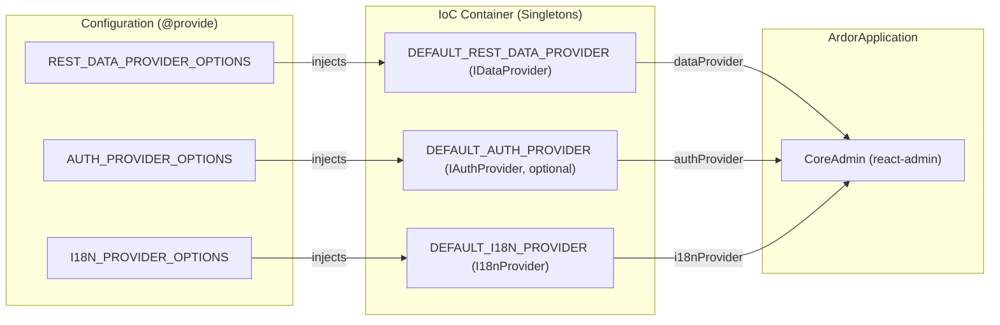

# Providers

ARDOR coordinates data, authentication, and internationalization through providers configured in `@configuration()` classes. `ArdorApplication` resolves them from the container and supplies them to react-admin:

<<< @/../../../examples/5-mins-qs/src/configurations/admin.configuration.ts{ts}

## Framework Providers

| Piece | What it does | Default class | Bound key | Options key | Required or optional | Reference |
| --- | --- | --- | --- | --- | --- | --- |
| Data provider | Maps react-admin data calls onto REST requests and provides custom HTTP sending methods | `DefaultRestDataProvider` | `CoreBindings.DEFAULT_REST_DATA_PROVIDER` | `CoreBindings.REST_DATA_PROVIDER_OPTIONS` | Required | [REST data provider](../../references/data-provider) |
| Auth provider | Manages authentication sessions, credentials, token storage, and auth error redirection | `DefaultAuthProvider` | `CoreBindings.DEFAULT_AUTH_PROVIDER` | `CoreBindings.AUTH_PROVIDER_OPTIONS` | Optional | [Auth provider](../../references/auth-provider) |
| i18n provider | Resolves translations, handles locale changes, and composes feature message bundles | `DefaultI18nProvider` | `CoreBindings.DEFAULT_I18N_PROVIDER` | `CoreBindings.I18N_PROVIDER_OPTIONS` | Required | [Internationalization](../../references/i18n) |
| Network service (transport) | Executes HTTP requests via fetch, attaches headers and tracing ids, and recovers from 401 errors | `DefaultNetworkRequestService` | None (constructed by data provider) | `CoreBindings.REST_DATA_PROVIDER_OPTIONS` | Required | [Network](../../references/network) |
| Permission provider | Evaluates authorization checks for resources, actions, and records via `canAccess` | None (`IPermissionProvider`) | `CoreBindings.PERMISSION_PROVIDER` | None | Optional | [Permission provider](../../references/permission) |
| Features | Bundles resources, custom routes, translation messages, and configuration classes for modular domains | None (array of `TFeature`) | `CoreBindings.FEATURES` | None | Optional | [Features](../../references/features) |

## Provider Flow into react-admin



`ArdorApplication` reads providers by key from the container when building props for react-admin; see [Application](./application). Components resolve them with `useProvider` or `useInjectable` (see [Dependency Injection](./dependency-injection)). When passed a `{ target }` class, `useProvider` checks that the class is registered under the `providers` namespace (`BindingNamespaces.PROVIDER`), throwing only when the class is bound under a different namespace.

## Replace One

To customize or replace a default provider, create a subclass that extends the default class, override the specific method, and bind the subclass under the corresponding `CoreBindings` key in a `@configuration()` class.

In `DefaultRestDataProvider` (`packages/admin/src/providers/rest-data.ts`), the helper and transport methods are public or protected methods of the class: `getListHelper` (public), `buildListFilter` (protected, a delegate of `ListFilterBuilder.build`), `toAffectedIds` (protected), `createNetworkService` (protected), `getDataSourceAuth` (public), and `getNetworkService` (public).

The following complete file illustrates subclassing `DefaultRestDataProvider` to override `getOne` and append a derived field to the returned record, registering the replacement provider under `CoreBindings.DEFAULT_REST_DATA_PROVIDER`:

```ts
import { type BaseArdorApplication, configuration, CoreBindings, DefaultRestDataProvider, inject, provide } from '@venizia/ardor';
import { type GetOneParams, type GetOneResult, type RaRecord } from 'ra-core';

export class CustomRestDataProvider extends DefaultRestDataProvider {
  override async getOne<RecordType extends RaRecord = RaRecord>(opts: {
    resource: string;
    params: GetOneParams<RecordType>;
  }): Promise<GetOneResult<RecordType>> {
    const result = await super.getOne(opts);
    return { ...result, data: { ...result.data, isLoaded: true } };
  }
}

@configuration()
export class CustomDataConfiguration {
  constructor(@inject({ key: CoreBindings.APPLICATION_INSTANCE }) private readonly application: BaseArdorApplication) {}

  @provide({ key: CoreBindings.DEFAULT_REST_DATA_PROVIDER })
  restDataProvider() {
    return this.application.instantiate(CustomRestDataProvider).value(this.application);
  }
}
```

Calling `this.application.instantiate(CustomRestDataProvider).value(this.application)` resolves constructor dependencies (`REST_DATA_PROVIDER_OPTIONS` and `APPLICATION_INFO`) and returns the react-admin provider.

## Leave One Out

Some administrative applications do not require authentication, authorization, or feature packages.

### Authentication (No Sign-In)

An application with no sign-in leaves `DEFAULT_AUTH_PROVIDER` unbound; `ArdorApplication` then runs without an auth provider:

1. **Leave `DEFAULT_AUTH_PROVIDER` unbound**: Do not declare `@provide({ key: CoreBindings.DEFAULT_AUTH_PROVIDER })` or `@provide({ key: CoreBindings.DEFAULT_AUTH_SERVICE })`.
2. **`ArdorApplication` handles omission**: When resolving `CoreBindings.DEFAULT_AUTH_PROVIDER`, `ArdorApplication` uses `isOptional: true`. When unbound, `authProvider` is omitted from the props passed to `CoreAdmin`.
3. **React-admin runs without auth**: No sign-in screen is rendered, and all resource routes and custom routes are immediately accessible.
4. **Configure network options**: In `REST_DATA_PROVIDER_OPTIONS`, set `noAuthPathRegex: /./` so that `DefaultNetworkRequestService` sends every HTTP request without attempting to attach an `Authorization` header.

### Permission Provider

`DefaultAuthProvider` injects `CoreBindings.PERMISSION_PROVIDER` with `isOptional: true`. In `DefaultAuthProvider.value()`, if `permissionProvider` is unbound, `authProvider.canAccess` is omitted, and react-admin allows every authorization check (`useCanAccess` resolves `canAccess: true`).

### Features

`BaseArdorApplication.features()` returns an empty array (`[]`) by default. When no features are mounted, `ArdorApplication` mounts only the resources and custom routes provided directly via application props (`<ArdorApplication resources={...} routes={...} />`).

## Next Steps

- [Configuration](./configuration) - Configure provider options and singleton bindings
- [Application](./application) - Mount providers in `<ArdorApplication />`
- [REST data provider](../../references/data-provider) - Complete data provider API reference
- [Auth provider](../../references/auth-provider) - Authentication options and session management
