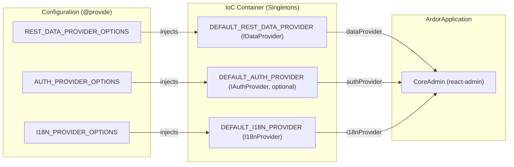

# Providers

ARDOR packages react-admin applications into an inversion-of-control container powered by IGNIS. The kernel defines eleven keys in `CoreBindings` (`packages/kernel/src/common/keys.ts`), and the framework coordinates six primary pieces:

| Piece | What it does | Default class | Bound key | Options key | Required or optional | Reference |
| --- | --- | --- | --- | --- | --- | --- |
| Data provider | Maps react-admin data calls onto REST requests and provides custom HTTP sending methods | `DefaultRestDataProvider` | `CoreBindings.DEFAULT_REST_DATA_PROVIDER` | `CoreBindings.REST_DATA_PROVIDER_OPTIONS` | Required | [REST data provider](../../references/data-provider) |
| Auth provider | Manages authentication sessions, credentials, token storage, and auth error redirection | `DefaultAuthProvider` | `CoreBindings.DEFAULT_AUTH_PROVIDER` | `CoreBindings.AUTH_PROVIDER_OPTIONS` | Optional | [Auth provider](../../references/auth-provider) |
| i18n provider | Resolves translations, handles locale changes, and composes feature message bundles | `DefaultI18nProvider` | `CoreBindings.DEFAULT_I18N_PROVIDER` | `CoreBindings.I18N_PROVIDER_OPTIONS` | Required | [Internationalization](../../references/i18n) |
| Network service (transport) | Executes HTTP requests via fetch, attaches headers and tracing ids, and recovers from 401 errors | `DefaultNetworkRequestService` | None (constructed by data provider) | `CoreBindings.REST_DATA_PROVIDER_OPTIONS` | Required | [Network](../../references/network) |
| Permission provider | Evaluates authorization checks for resources, actions, and records via `canAccess` | None (`IPermissionProvider`) | `CoreBindings.PERMISSION_PROVIDER` | None | Optional | [Permission provider](../../references/permission) |
| Features | Bundles resources, custom routes, translation messages, and configuration classes for modular domains | None (array of `TFeature`) | `CoreBindings.FEATURES` | None | Optional | [Features](../../references/features) |

You configure providers through `@configuration()` classes by declaring options and provider instances with `@provide({ key })` methods. During startup, `start()` discovers these classes and registers each provided key into the container as a lazy singleton. When React mounts, `ArdorApplication` resolves the default providers by key from the container and supplies them directly to react-admin's `<CoreAdmin />`.

The standard configuration from `examples/5-mins-qs/src/configurations/admin.configuration.ts` demonstrates how options and provider instances are declared:

<<< @/../../../examples/5-mins-qs/src/configurations/admin.configuration.ts{ts}

`IDataProvider` (defined in `packages/admin/src/common/types.ts`) extends react-admin's nine standard data methods (`getList`, `getOne`, `getMany`, `getManyReference`, `update`, `updateMany`, `create`, `delete`, `deleteMany`) with exactly three additional framework methods: `send`, `getNetworkService`, and `getDataSourceAuth`.

`preConfigure()` directly binds `APPLICATION_INSTANCE`, `APPLICATION_INFO`, and `FEATURES`; for the complete six-step bind order, see [Configuration](./configuration).

Detailed option tables for each provider are documented in their respective reference pages. For instance, post-login redirection is configured at `paths.afterLogin` inside `CoreBindings.AUTH_PROVIDER_OPTIONS`, as documented in [Auth provider](../../references/auth-provider).

## Provider Flow into react-admin

The following diagram illustrates how options configure provider classes, how provider instances are registered in the IoC container, and how `ArdorApplication` injects them into react-admin:



### How a Provider Reaches react-admin

`ArdorApplication` reads the data provider and i18n provider (required) and the auth provider (optional) by key from the container when building props for react-admin; see [Application](./application).

### How Other Code Reaches Providers and Services

Custom React components and hooks reach providers and services using `useProvider` and `useInjectable` from `@venizia/ardor` (for the complete hook table, see [Dependency Injection](./dependency-injection)). When passed a `{ target }` class, `useProvider` checks that the class is registered under the `providers` namespace (`BindingNamespaces.PROVIDER`), throwing only when the class is bound under a different namespace.

The following example demonstrates resolving the data provider from custom components using both `useInjectable` and `useProvider`:

```tsx
import {
  CoreBindings,
  type IDataProvider,
  useInjectable,
  useProvider,
} from '@venizia/ardor';

export const CustomToolbar = () => {
  // Resolve data provider by key via useInjectable
  const dataProvider = useInjectable<IDataProvider>({
    key: CoreBindings.DEFAULT_REST_DATA_PROVIDER,
  });

  // Resolve data provider by key via useProvider
  const provider = useProvider<IDataProvider>({
    key: CoreBindings.DEFAULT_REST_DATA_PROVIDER,
  });

  return null;
};
```

## Replace One

To customize or replace a default provider, create a subclass that extends the default class, override the specific method, and bind the subclass under the corresponding `CoreBindings` key in a `@configuration()` class.

In `DefaultRestDataProvider` (`packages/admin/src/providers/rest-data.ts`), the helper and transport methods are public or protected methods of the class: `getListHelper` (public), `buildListFilter` (protected), `toAffectedIds` (protected), `createNetworkService` (protected), `getDataSourceAuth` (public), and `getNetworkService` (public).

The following complete file illustrates subclassing `DefaultRestDataProvider` to override `getOne` and append a derived field to the returned record, registering the replacement provider under `CoreBindings.DEFAULT_REST_DATA_PROVIDER`:

```ts
import { type BaseArdorApplication, configuration, CoreBindings, DefaultRestDataProvider, inject, provide } from '@venizia/ardor';
import { type GetOneParams, type GetOneResult, type RaRecord } from 'ra-core';

export class CustomRestDataProvider extends DefaultRestDataProvider {
  override async getOne<RecordType extends RaRecord = RaRecord>(opts: {
    resource: string;
    params: GetOneParams<RecordType>;
  }): Promise<GetOneResult<RecordType>> {
    const result = await super.getOne(opts);
    return { ...result, data: { ...result.data, isLoaded: true } };
  }
}

@configuration()
export class CustomDataConfiguration {
  constructor(@inject({ key: CoreBindings.APPLICATION_INSTANCE }) private readonly application: BaseArdorApplication) {}

  @provide({ key: CoreBindings.DEFAULT_REST_DATA_PROVIDER })
  restDataProvider() {
    return this.application.instantiate(CustomRestDataProvider).value(this.application);
  }
}
```

In this implementation:
- `CustomRestDataProvider` inherits the constructor of `DefaultRestDataProvider`, which receives injected `REST_DATA_PROVIDER_OPTIONS` and `APPLICATION_INFO`.
- `this.application.instantiate(CustomRestDataProvider)` resolves those constructor dependencies from the container.
- `.value(this.application)` returns the react-admin shaped provider.
- Because `@provide({ key: CoreBindings.DEFAULT_REST_DATA_PROVIDER })` binds under the standard key as a singleton, both react-admin and framework hooks share the customized data provider.

## Leave One Out

Some administrative applications do not require authentication, authorization, or feature packages. ARDOR supports omitting each of these pieces cleanly without boilerplate workarounds.

### Authentication (No Sign-In)

If an administrative console runs without authentication (such as an internal tooling dashboard or public reporting console):

1. **Leave `DEFAULT_AUTH_PROVIDER` unbound**: Do not declare `@provide({ key: CoreBindings.DEFAULT_AUTH_PROVIDER })` or `@provide({ key: CoreBindings.DEFAULT_AUTH_SERVICE })`.
2. **`ArdorApplication` handles omission**: When resolving `CoreBindings.DEFAULT_AUTH_PROVIDER`, `ArdorApplication` uses `isOptional: true`. When unbound, `authProvider` is omitted from the props passed to `CoreAdmin`.
3. **React-admin runs without auth**: No sign-in screen is rendered, and all resource routes and custom routes are immediately accessible.
4. **Configure network options**: In `REST_DATA_PROVIDER_OPTIONS`, set `noAuthPathRegex: /./` so that `DefaultNetworkRequestService` sends every HTTP request without attempting to attach an `Authorization` header.

The following complete file shows a configuration for an application without authentication:

```ts
import {
  type BaseArdorApplication as TArdorApplication,
  configuration,
  CoreBindings,
  DefaultI18nProvider,
  DefaultRestDataProvider,
  inject,
  provide,
} from '@venizia/ardor';

@configuration()
export class PublicAdminConfiguration {
  constructor(
    @inject({ key: CoreBindings.APPLICATION_INSTANCE })
    private readonly application: TArdorApplication,
  ) {}

  @provide({ key: CoreBindings.REST_DATA_PROVIDER_OPTIONS })
  restDataProviderOptions() {
    return {
      url: 'https://api.example.com',
      noAuthPathRegex: /./,
    };
  }

  @provide({ key: CoreBindings.DEFAULT_REST_DATA_PROVIDER })
  restDataProvider() {
    return this.application.instantiate(DefaultRestDataProvider).value(this.application);
  }

  @provide({ key: CoreBindings.I18N_PROVIDER_OPTIONS })
  i18nProviderOptions() {
    return { languages: [{ locale: 'en', name: 'English' }] };
  }

  @provide({ key: CoreBindings.DEFAULT_I18N_PROVIDER })
  i18nProvider() {
    return this.application.instantiate(DefaultI18nProvider).value(this.application);
  }
}
```

### Permission Provider (Unbound = Every Check Passes)

In ARDOR, permission decisions are handled through react-admin's `canAccess` contract:

- `DefaultAuthProvider` injects `CoreBindings.PERMISSION_PROVIDER` with `isOptional: true`.
- In `DefaultAuthProvider.value()`, if `permissionProvider` is unbound or undefined, the returned `IAuthProvider` object omits the `canAccess` property entirely.
- When `authProvider.canAccess` is absent, react-admin treats every authorization check as allowed (`useCanAccess` resolves `canAccess: true`).
- To allow full access across all resources and actions, leave `CoreBindings.PERMISSION_PROVIDER` unbound.

### Features (Empty by Default)

Features package resources, routes, translation bundles, and configuration classes for modular business domains:

- `BaseArdorApplication.features()` returns an empty array (`[]`) by default.
- During `preConfigure()`, `this.registerFeatures({ features: this.features() })` binds `CoreBindings.FEATURES` to that list.
- When no features are mounted, `ArdorApplication` mounts only the resources and custom routes provided directly via application props (`<ArdorApplication resources={...} routes={...} />`).
- Leaving features empty incurs no overhead and registers no additional routes or message bundles.

## Next Steps

- Configure provider options and singleton bindings: [Configuration](./configuration)
- Application lifecycle and startup steps: [Application](./application)
- Declare resource views and custom routes: [Resources and Pages](./resources-and-pages)
- Manage dependency injection and stereotypes: [Dependency Injection](./dependency-injection)
- REST data provider technical reference: [REST data provider](../../references/data-provider)
- Authentication provider technical reference: [Auth provider](../../references/auth-provider)
- Internationalization technical reference: [Internationalization](../../references/i18n)
- Network service technical reference: [Network](../../references/network)
- Permission provider technical reference: [Permission provider](../../references/permission)
- Feature modularization technical reference: [Features](../../references/features)
- Container hooks technical reference: [Hooks](../../references/hooks)
